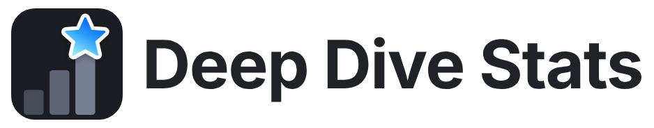
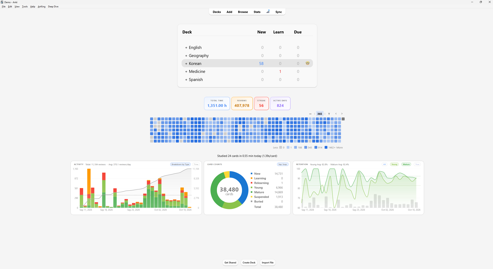
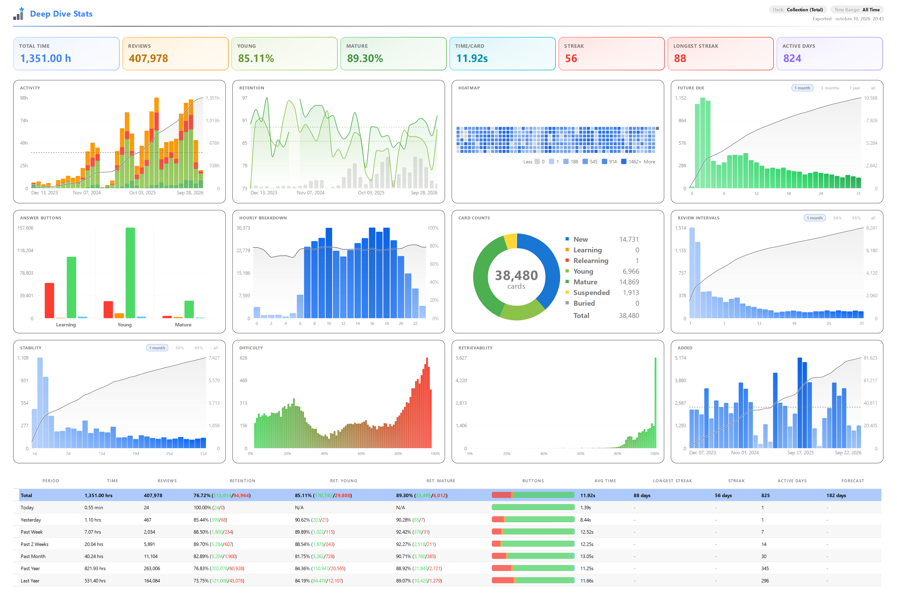

<p align="center">
  <picture>
    <source media="(prefers-color-scheme: dark)" srcset="docs/banner-dark.png">
    
  </picture>
</p>

<p align="center">
  <a href="https://ankiweb.net/shared/review/1498951013"></a>
  <a href="#install"></a>
  <a href="https://ko-fi.com/mathieu_"></a>
</p>

Detailed statistics for Anki, in a separate window or pinned under your deck list. Any stat or chart can be pinned.

### Pinned to the main screen



### Separate stats window



## Features

- Deep Dive window with stats per deck and per period, and a table by deck or
  by time span.
- Charts: activity, retention, heatmap, future due, answer buttons, hours of the
  day, card counts, review intervals, cards added, FSRS stability, difficulty
  and retrievability.
- More than 30 more charts in the widget gallery: card history, load and due,
  ratings and time, FSRS (calibration, forgetting curves, stability over
  time), plus custom bar and pie charts.
- Arrange the window your way: drag, resize and remove charts, add any chart
  or stat card from the gallery.
- Pin stat cards, charts, the heatmap and text to the deck list and the deck
  overview. Text widgets can show live stats, like today's reviews.
- Zoom into time charts; zoomed charts can follow each other.
- Settings per chart, built-in themes and custom colors, adjustable
  animations.
- Export as PNG, JPEG, PDF or CSV.
- Available in 11 languages, with a guided tour on first start.

## Install

Install it from [AnkiWeb](https://ankiweb.net/shared/info/1498951013): in Anki, go to
Tools > Add-ons > Get Add-ons, enter the code `1498951013` and restart.

You can also build the `.ankiaddon` yourself (see Build below) and use
Tools > Add-ons > Install from file.

Needs Anki 23.10.1 or newer (Qt 6 build). Tested on Anki 26.09.

If the pinned charts clash with another add-on, turn them off in
Settings > General > "Disable Pinned Widgets".

## Bugs and ideas

Open an issue on GitHub. The log is `user_files/debug.log` in the add-on folder.
Paths and the profile name are redacted, so you can attach the relevant lines.

## Translations

Some translations may be wrong. To fix one, no GitHub knowledge is needed: open a new issue, choose
**Translation fix**, and fill in the language, the current text and the correction.

You can also send a pull request: texts live in `src/i18n/<language>.json`.

## Build

```
python dev_tools/build_release.py
```

Writes `dist/releases/Deep_Dive_Stats_<version>.ankiaddon`. Add `--check` to only run the audit.
`dev_tools/check_import_graph.py` imports every module without starting Anki.

## Support

If you find this add-on useful, a [thumbs up on AnkiWeb](https://ankiweb.net/shared/review/1498951013) helps other
people find it. You can also support me on [Ko-fi](https://ko-fi.com/mathieu_).

## Credits

Many of the extra charts are based on
[Search Stats Extended](https://github.com/Luc-Mcgrady/Anki-Search-Stats-Extended)
by Luc McGrady.

Icons from [Lucide](https://lucide.dev) (ISC License).

## License

GNU AGPL v3 or later, the same license as Anki itself. See `LICENSE`.
