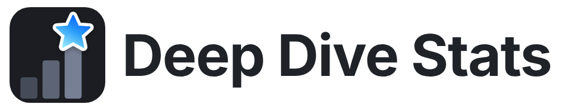
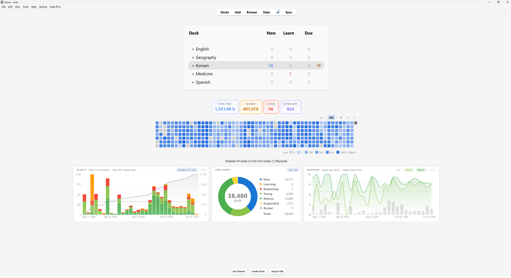
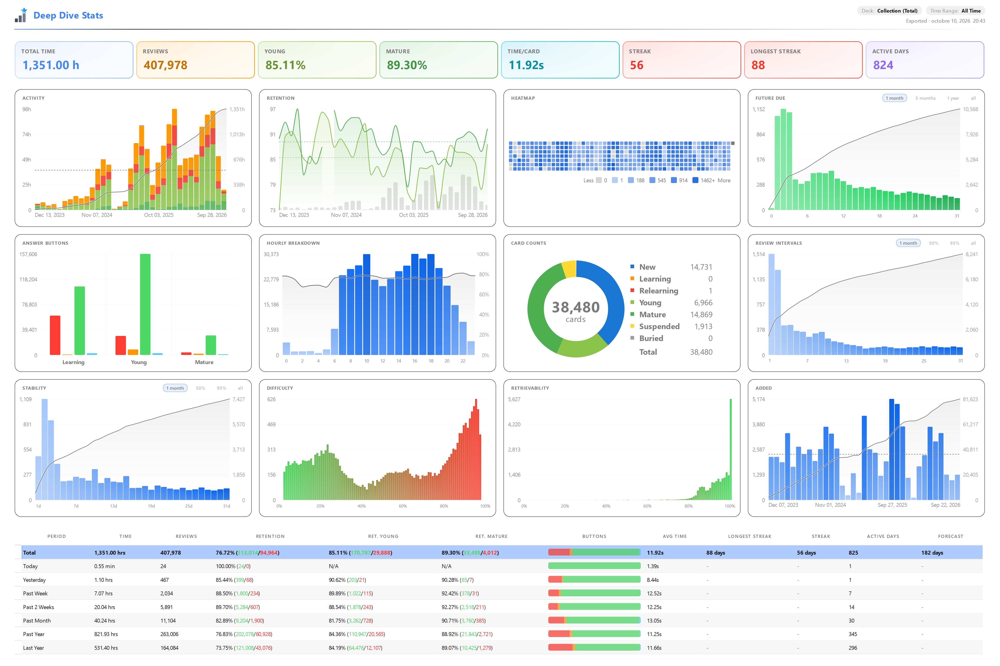

<p align="center">
  <picture>
    <source media="(prefers-color-scheme: dark)" srcset="docs/banner-dark.png">
    
  </picture>
</p>

Detailed statistics for Anki, in a separate window or pinned under your deck list. Any stat or chart can be pinned.

### Pinned to the main screen



### Separate stats window



## Features

- Deep Dive window with stats per deck and per period, and a table by deck or
  by time span.
- Charts: activity, retention, heatmap, future due, answer buttons, hours of the
  day, card counts, review intervals, cards added, FSRS stability, difficulty
  and retrievability.
- Pin stat cards, charts, the heatmap and text to the deck list and the deck
  overview.
- Settings per chart, built-in themes and custom colors.
- Export as PNG, JPEG, PDF or CSV.

## Install

Download `Deep_Dive_Stats.ankiaddon` from the Releases page of this repository,
then in Anki use Tools > Add-ons > Install from file and restart.

Needs Anki 23.10 or newer. Tested on Anki 26.09.

If the pinned charts clash with another add-on, turn them off in
Settings > General > "Disable Pinned Widgets".

## Bugs and ideas

Open an issue on GitHub. The log is `user_files/debug.log` in the add-on folder.
Paths and the profile name are redacted, so you can attach the relevant lines.

## Build

```
python dev_tools/build_release.py
```

Writes `dist/Deep_Dive_Stats.ankiaddon`. Add `--check` to only run the audit.
`dev_tools/check_import_graph.py` imports every module without starting Anki.

## Support

If the add-on helps you, you can support me on [Ko-fi](https://ko-fi.com/mathieu_).

## License

GNU AGPL v3 or later, the same license as Anki itself. See `LICENSE`.
